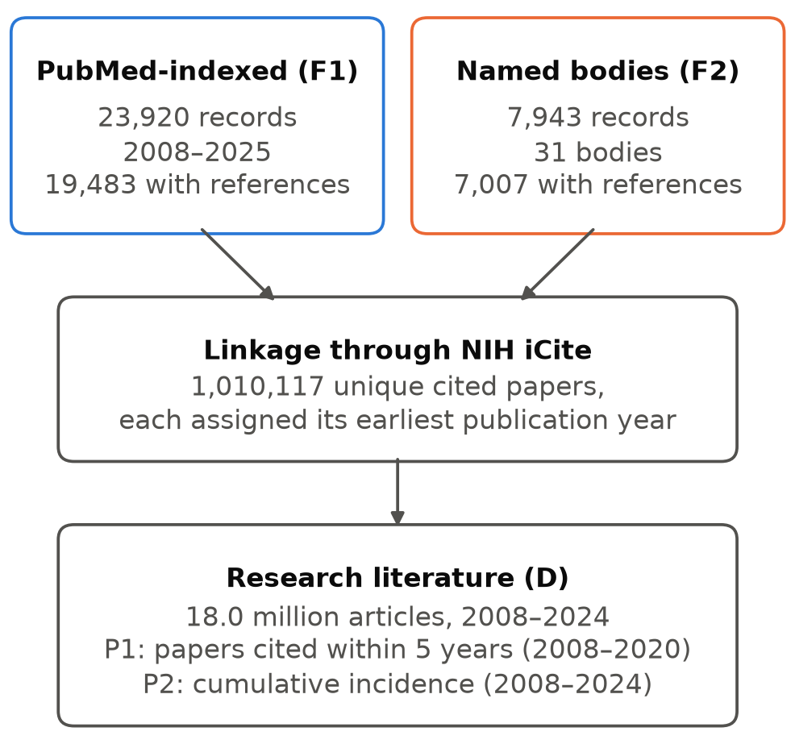
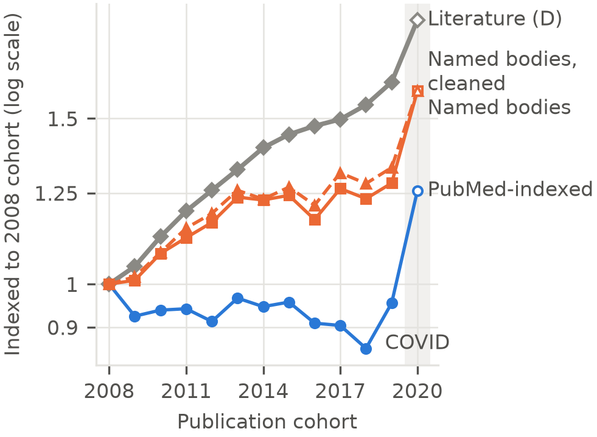
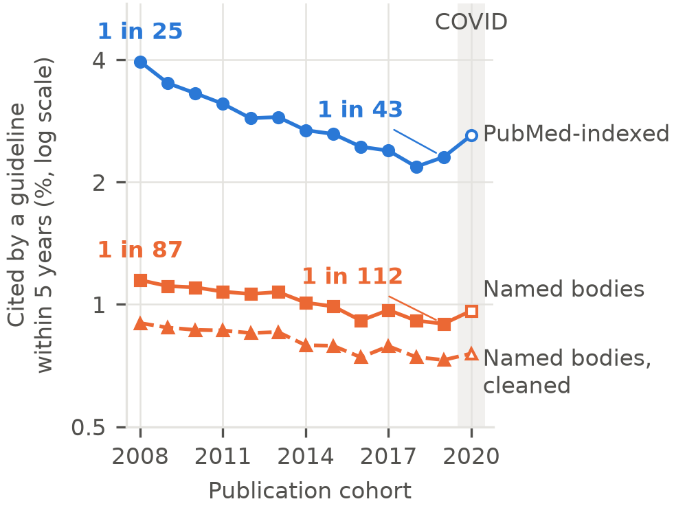
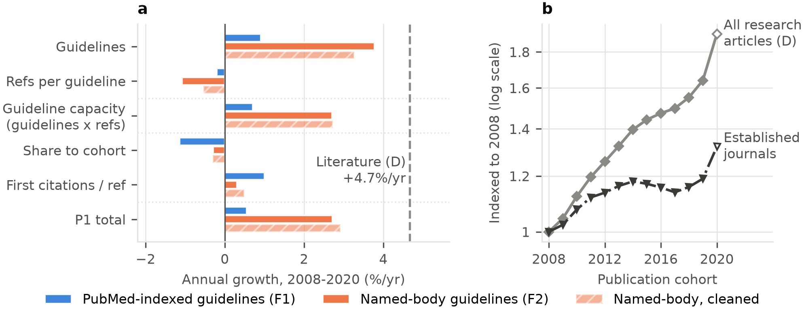
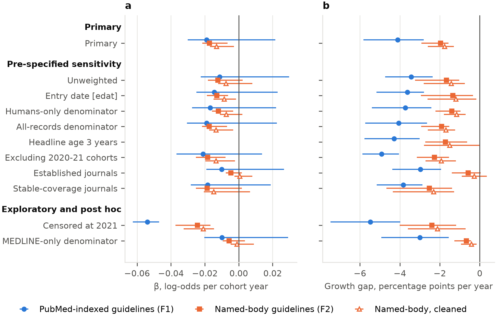

# Guideline citation and the growth of PubMed: a pre-registered cohort study, 2008–2024

**Jordan Fulcher**

Independent researcher, Norwich, United Kingdom

ORCID: https://orcid.org/0009-0001-6294-1127

**Corresponding author:** Jordan Fulcher, jfulcherresearch@gmail.com

**Author contributions:** JF is the sole author and was responsible for conceptualisation, methodology, investigation (including all manual coding for the validation gates), data curation, formal analysis, visualisation, and writing (original draft, review and editing).

**Acknowledgments:** none.

**Word count:** abstract 248; main text 4049 (Introduction to Conclusions, excluding tables and figure captions).

**Registration:** Open Science Framework, https://doi.org/10.17605/OSF.IO/VN9BQ (16 October 2026).

## Abstract

Citations from clinical practice guidelines are used as a marker of the practice relevance of research, but whether research drawn on by guidelines keeps pace with the growing biomedical literature is unknown. In a pre-registered cohort study, we linked 18.0 million PubMed research articles published from 2008 to 2024, through the National Institutes of Health Open Citation Collection, to the reference lists of 23,920 guidelines indexed in PubMed and 7,943 guidelines from 31 named national and international bodies. Research articles per year nearly doubled between 2008 and 2020 (4.7% a year), while papers cited by a guideline within five years grew 0.6% and 2.7% a year, 4.1 and 2.0 percentage points a year slower than the literature. The five-year probability of guideline citation fell from 1 in 25 papers (2008) to 1 in 43 (2019) for PubMed-indexed guidelines, and from 1 in 87 to 1 in 112 for named bodies. A decline across cohorts in the odds of citation was supported for named bodies (odds ratio 0.983 per year; 95% confidence interval 0.978 to 0.993) but inconclusive for PubMed-indexed guidelines, which a 2022–23 indexing gap affected. Guideline citation capacity grew only 0.7–2.7% a year. Restricted post hoc to articles indexed for MEDLINE, which grew 2.5% a year, guideline-cited papers still lagged the literature but the cohort trend was inconclusive, as within journals already cited by guidelines. The dilution is concentrated outside MEDLINE and outside established journals, so indicators built on PubMed totals partly reflect the database's widening scope.

**Keywords:** clinical practice guidelines; research impact; citation analysis; PubMed; MEDLINE; literature growth

## 1. Introduction

Biomedical publication volume has expanded steadily for decades: across PubMed records matching the term "medical", annual output grows by about 7% a year (Eva, 2026). Popular claims that medical knowledge doubles every 73 days rest on a category error that equates the number of published articles with knowledge (Eva, 2026). Publication volume alone does not measure progress. A rising number of papers could reflect a matching expansion in useful evidence, or growth in studies that add to the literature without informing patient care.

For patients, what matters is whether relevant research reaches the evidence syntheses that inform their care. Clinicians and guideline developers already struggle to keep up with the daily volume of new trials and systematic reviews (Bastian et al., 2010), and much research is wasted through avoidable flaws in design, conduct and reporting (Chalmers & Glasziou, 2009). If the literature grows faster than the share of research that is ever used in clinical guidance, each useful paper sits among a growing volume of papers that are not.

Clinical practice guidelines are a principal, clinically authored route from research to care, and the one whose use of evidence can be observed for every paper in PubMed. Other routes, including systematic reviews, health technology assessment, formularies, regulatory decisions and point-of-care summaries, are not captured here. Our outcome is guideline-cited research: research cited in the reference lists of clinical practice guidelines from reputable national or international bodies. Being cited by a guideline does not mean that practice changed; uptake of guideline recommendations in routine care is partial and slow (Cabana et al., 1999; Grimshaw et al., 2004). But citation is an upstream gate: research cannot inform a recommendation without first being cited by it. Partial uptake limits how much cited research changes care, but not whether the gate itself is widening or narrowing. Guideline citation is therefore an observable, upstream marker of practice relevance, not a measure of clinical change.

Bibliometric research has long charted the growth of the scientific literature (Bornmann & Mutz, 2015; Bornmann et al., 2021), and has used citations from clinical guidelines and other policy documents as indicators of research impact beyond academia (Grant et al., 2000; Kryl et al., 2012; Szomszor & Adie, 2022; Thelwall & Maflahi, 2016). Growth estimates depend on the database used (Bornmann et al., 2021), which matters when a database's scope changes over the period studied.

Earlier bibliometric studies have described the evidence base of particular guidelines: its age, origin and funding (Grant et al., 2000; Kryl et al., 2012; Lewison & Sullivan, 2008; Pallari et al., 2018). Others have started from the research itself, predicting which papers will be cited by clinical trials or guidelines (Hutchins, Davis, et al., 2019) and measuring how long papers take to receive their first citation from either (Li et al., 2024). To our knowledge, no study has tested whether the probability that a newly published paper reaches a guideline has changed across publication cohorts as volume grew. In a pre-registered cohort study of 18.0 million PubMed research articles published from 2008 to 2024, we tested whether guideline-cited research has kept pace with the literature and, if not, why.

## 2. Methods

### 2.1 Design, registration and reporting
Retrospective cohort study of publication-year cohorts using public bibliographic data. All PubMed and iCite records were publicly accessible in full. The study is a census of all eligible records, so no sample size was calculated. Registered on the Open Science Framework (OSF) before outcome data were analysed (16 October 2026; doi:10.17605/OSF.IO/VN9BQ). The final protocol (v2.3.4) is at osf.io/hpg6f. Deviations are listed in §2.8. Reporting: a checklist adapted from RECORD (REporting of studies Conducted using Observational Routinely-collected health Data; Benchimol et al., 2015), the extension of STROBE (Strengthening the Reporting of Observational Studies in Epidemiology; von Elm et al., 2007), is supplied as Online Resource 2.

### 2.2 Terms used

| In the text | Symbol (Methods, tables) | Definition |
|---|---|---|
| Research literature | D | Research-type journal articles per publication year (§2.4) |
| PubMed-indexed guidelines | F1 | Guidelines tagged "Practice Guideline" in PubMed |
| Named-body guidelines | F2 | Guidelines from 31 pre-specified guideline bodies |
| Guideline-cited papers | P1 | Papers first cited by a guideline within 5 years of publication |
| Probability of guideline citation | P2 | Kaplan–Meier cumulative incidence of first guideline citation |
| Cohort trend | β | Change per cohort year in the log-odds hazard of first citation |
| Growth gap | g₁ − g_D | Annual growth of P1 minus annual growth of D |

### 2.3 Guidelines
**Two co-primary frames, fixed before extraction.** **PubMed-indexed guidelines (F1):** records with the publication type "Practice Guideline", 2008–2025, excluding preprints. **Named-body guidelines (F2):** records from 31 pre-specified national and international guideline bodies, matched by collective author, byline or title acronym, with a guideline-type word in the title or abstract. Recall against 50 pre-specified landmark guidelines was 0.92. National Center for Biotechnology Information (NCBI) Bookshelf records (4.1% of F1) never carry iCite references; they were excluded from coverage denominators and are reported as a gap.

### 2.4 Research literature
Journal articles excluding comments, editorials, letters, news, errata, guidelines and preprints. Records matching two adjacent publication years (about 10%) were counted once, in the earlier year. A denominator based on Medical Subject Headings (MeSH) was rejected because the share of records tagged Humans[mh] drifts (63% in 2005, 49% in 2025).

### 2.5 Linkage and outcomes
Guideline reference lists came from iCite, the National Institutes of Health (NIH) Open Citation Collection (Hutchins, Baker, et al., 2019; 19,483 F1 and 7,007 F2 guidelines with references; 1,010,117 unique cited papers; extracted 19 October 2026). Cited papers were matched to the research literature on the PubMed History server, so every guideline-cited paper is an exact member of the denominator. For each paper, the first-citation year is the earliest year a frame guideline cited it. **Guideline-cited papers (P1):** number per cohort first cited within 5 years, cohorts 2008–2020. Five years was fixed by a pre-specified rule (42% of references in a 2015 pilot were ≤5 years old, above the 40% threshold). **Probability of guideline citation (P2):** Kaplan–Meier cumulative incidence from cohort life tables, cohorts 2008–2024, follow-up to 2025. We also report it as "1 in N" (N = 1 ÷ five-year cumulative incidence).

### 2.6 Coverage correction and validation
iCite reference coverage of F1 rose from 0.70 (2008) to 0.88 (2025), which would mimic growth. Each first citation was weighted by the inverse of coverage in the citing guideline's year; the unweighted analysis is a sensitivity analysis. This weighting is an approximation: it treats first-citation events as independent of how many guidelines cite a paper, and a citation missing from iCite in an earlier year can shift the observed first-citation age later. Missing reference lists depend on whether publishers deposit references in the open citation sources behind iCite (Hutchins, Baker, et al., 2019), so missingness is related to journal and publisher rather than random; a pre-specified sensitivity analysis restricted to journals with stable coverage addresses this. Four pre-specified validation gates were run before outcome analysis: reference coverage in iCite (G1), whether retrieved records were eligible guidelines (G2), matching of National Institute for Health and Care Excellence (NICE) references to PubMed (G3), and how guidelines use the papers they cite (G4). Results are in Table 1 and Online Resource 1, S1.

### 2.7 Statistical analysis
**Growth gap (H2):** log-linear regression of P1 and of D on cohort year (2008–2020). H2 is supported if the 95% confidence interval (CI) of g₁ − g_D lies below 0. **Cohort trend (H1):** discrete-time logistic hazard, logit h(a, Y) = f(a) + β(Y − 2008), with one indicator per age. H1 is supported if β < 0 with a CI excluding 0. Proportional hazards were checked by adding interactions between cohort year and citation-age bands 2–4 and ≥5 years (ages 0–1 as reference). **Uncertainty:** moving-block bootstrap of cohort years (block length 3, 999 replicates). D is a census and carries no sampling error. **Why the gap (decomposition):** P1 = guidelines × references per guideline × share of references to the cohort × first citations per reference; the annual log-growth of the four factors sums to that of P1. Guideline citation capacity = guidelines × references per guideline. **Sensitivity analyses (pre-specified):** unweighted; entry date (`[edat]`); alternative denominators (Humans only; all records; journals that guidelines cited in 2008–2012, "established journals"); 3-year headline age; excluding the 2020–21 COVID cohorts; journals with stable coverage; F1 against F2 in 2022–23. **Other pre-specified analyses** (breakpoints, selected high-volume designs, a post-2022 change, H3) are reported in Online Resource 1. Python (numpy, pandas); code is public.

### 2.8 Deviations from the registered protocol
1. Added sensitivity analysis: cleaned F2, a rule-based filter decided after G2 scoring and before outcome analysis (Online Resource 1, S2).
2. The G4 recode was opened about 1.5 hours before 14 × 24 hours had elapsed.
3. G3: appendix files were clarified as not evidence reviews, and the reference parser corrected, both before matching.
4. Exploratory: F1 and F2 with follow-up censored at 2021, within the pre-specified F1-versus-F2 2022–23 comparison.
5. H3(b) bootstrap replicates without post-2022 cohorts were excluded and are reported.
6. Post hoc, decided after the primary results: (a) a MEDLINE-only denominator (research articles also indexed for MEDLINE), to separate growth in publishing from growth in what PubMed indexes; (b) bootstrap block lengths of 2 and 4 cohort-years, to check the calibration of intervals based on 13–17 cohorts.

### 2.9 Use of AI tools
Claude Opus 5.5 (Anthropic) was used to support coding and to provide editing support on the manuscript. The author reviewed all outputs and takes full responsibility for the content.

## 3. Results

### 3.1 Study population and validity (Fig. 1, Table 1)
18.0 million research articles (2008–2024) were linked to 23,920 PubMed-indexed and 7,943 named-body guidelines, which together cited 1,010,117 unique papers (Fig. 1). Coverage was ≥0.70 from 2008. Eligibility precision was 0.90 for PubMed-indexed guidelines and 0.63 for named-body guidelines, below the 0.80 threshold; a cleaned named-body set reached 0.80 and gave the same primary conclusions, though not in every sensitivity analysis (Online Resource 1, S2 and S6). In a citation-context sample, 52% of citations to research papers were evidence behind a recommendation; the rest were background or methods (Online Resource 1, S1). Intra-rater agreement on this distinction was only fair (κ 0.38). In a pilot of 10 NICE guidelines, which are published as books and so absent from iCite, the median age of cited papers was 9 years (7 for PubMed-indexed guidelines), and only 23% of NICE-cited papers were cited by any PubMed-indexed guideline (9% by any named-body guideline). Guidelines published outside journals draw on a largely different, older evidence base (Online Resource 1, S7).

**Fig. 1** Study flow. Boxes show the two guideline sets with the number of records and of guidelines with iCite reference lists, the cited papers retrieved through iCite, and the research-literature denominator (D) of 18.0 million articles (2008–2024) to which cited papers were linked by publication cohort; arrows show the direction of linkage

**Table 1. Validation gates**

| Gate | Measure | Result | Intra-rater κ | Threshold |
|---|---|---|---|---|
| G1 | iCite reference coverage, PubMed-indexed guidelines, 2008 / 2025 | 0.70 / 0.88 | — | ≥0.70 |
| G2 | Eligibility precision, PubMed-indexed (n = 200) | 0.895 (0.845–0.930) | 0.61 | ≥0.80 |
| G2 | Eligibility precision, named bodies (n = 100) | 0.630 (0.532–0.718) | 0.73 | ≥0.80 |
| G3 | NICE references matched to a PMID (journal-like) | 0.855 (0.839–0.870) | — | ≥0.60 |
| G4 | Citations that are evidence for a recommendation | 0.52 (0.39–0.65) | 0.38 | descriptive |

### 3.2 The literature nearly doubled; guideline-cited papers did not (Fig. 2, Table 2)
Research articles grew from 0.69 million (2008) to 1.32 million (2020), 4.7% a year (doubling time 14.8 years). Papers cited by a PubMed-indexed guideline within five years were essentially flat: 27,417 from the 2008 cohort and 26,177 from 2019 (0.6% a year, 95% CI −1.5 to 1.5). Those cited by named bodies grew 2.7% a year (0.4 to 4.0). Guideline-cited papers therefore grew 4.1 percentage points a year more slowly than the literature for PubMed-indexed guidelines (2.8 to 5.8) and 2.0 more slowly for named bodies (1.6 to 2.9). H2 was supported in both frames.

**Fig. 2** Growth of guideline-cited papers against the research literature by publication cohort (2008–2020), indexed to the 2008 cohort (log scale). Diamonds and thick solid line: research articles (D). Circles: papers first cited by a PubMed-indexed guideline within 5 years. Squares, solid line: the same for named-body guidelines. Triangles, dashed line: the cleaned named-body set. The shaded band marks the 2020 cohort (COVID-19 publication surge), shown with open markers. Each cohort is a census of 0.7–1.3 million papers; binomial 95% intervals for each point are within ±3% of the estimate and smaller than the markers

### 3.3 The chance that a paper reaches a guideline fell (Fig. 3, Table 2)
The five-year probability of citation by a PubMed-indexed guideline fell from 3.96% (2008) to 2.31% (2019): from 1 paper in 25 to 1 in 43. For named bodies it fell from 1.15% to 0.90%: from 1 in 87 to 1 in 112. We compare with 2019 because it is the last cohort before the COVID-19 publication surge. The 2020 cohort, which also has five years of follow-up, gave 2.61% (1 in 38) and 0.96% (1 in 104); the lowest values were in 2018 (Fig. 3). For named bodies, the cohort trend was β = −0.017 (−0.022 to −0.007), an odds ratio of 0.983 per year; H1 was supported. For PubMed-indexed guidelines, β was similar (−0.019) but its CI included 0 (−0.030 to 0.022), so H1 was not formally supported. We attribute this to a fall in PubMed "Practice Guideline" tagging in 2022–23 (1,708 records in 2020, 1,022–1,083 in 2022–23, 1,720–1,945 in 2024–25), which is absent from named-body guidelines (Online Resource 1, Fig. S1). The 2021–24 cohorts, whose early follow-up falls in that gap and recovery, widen the interval. Excluding the 2020–21 cohorts (pre-specified) did not remove the problem (β = −0.021, −0.037 to 0.014), because the 2022–24 cohorts remain and earlier cohorts are still followed through 2022–25. Censoring all follow-up at calendar year 2021 removes the gap and recovery: β = −0.054 (−0.063 to −0.047). This analysis was not pre-specified and is exploratory. The pre-specified proportional-hazards check pointed the same way. For named bodies the cohort trend was similar at all citation ages (age × cohort interactions −0.009 at ages 2–4 and −0.009 at ≥5). For PubMed-indexed guidelines it was not (+0.005 and +0.049), consistent with the 2024–25 indexing recovery inflating late-age hazards for older cohorts.

**Fig. 3** Five-year probability of first guideline citation by publication cohort: Kaplan–Meier cumulative incidence from coverage-weighted life tables (log scale). Circles: PubMed-indexed guidelines. Squares, solid line: named-body guidelines. Triangles, dashed line: the cleaned named-body set, a subset of named-body guidelines. Labels give the probability as 1 in N research papers for the 2008 and 2019 cohorts; 2019 is the last cohort before the COVID-19 surge. The shaded band marks the 2020 cohort, shown with open markers. Binomial 95% intervals for each point are within ±3% of the estimate and smaller than the markers; uncertainty in the trend is shown in Fig. 5

**Table 2. Primary results** (95% CIs)

| Guidelines | Cited within 5 y, 2008 → 2019 | Probability, 2008 → 2019 | 1 in N, 2008 → 2019 | Growth gap, points/yr | Odds ratio per year |
|---|---|---|---|---|---|
| PubMed-indexed | 27,417 → 26,177 | 3.96% → 2.31% | 25 → 43 | −4.1 (−5.8 to −2.8) | 0.981 (0.970 to 1.022) |
| Named bodies | 7,945 → 10,175 | 1.15% → 0.90% | 87 → 112 | −2.0 (−2.9 to −1.6) | 0.983 (0.978 to 0.993) |
| Named bodies, cleanedᵃ | 6,228 → 8,284 | 0.90% → 0.73% | 111 → 137 | −1.8 (−2.6 to −1.3) | 0.987 (0.983 to 0.997) |

Counts of cited papers are coverage-weighted estimates, so they need not be whole numbers; they are shown rounded. "1 in N" is computed from unrounded cumulative incidence (N = 1 ÷ incidence, rounded); for example, 0.896% gives 1 in 112. 2019 is the last cohort before the COVID-19 surge; 2020 values are given in §3.3. ᵃAdded sensitivity analysis (deviation 1), shown because the uncleaned named-body frame fell short of its eligibility-precision threshold (Table 1).

### 3.4 Why: guideline capacity, and where the growth is (Fig. 4)
**Capacity.** From the 2008 to the 2020 cohort, the number of guidelines grew 0.9% a year (PubMed-indexed) and 3.8% (named bodies), while references per guideline changed by −0.2% and −1.1%. Guideline citation capacity therefore grew 0.7% and 2.7% a year, against 4.7% for the literature. **Recent research largely kept its share.** The share of guideline references going to any one recent cohort changed little (−1.1% and −0.3% a year). In accounting terms, the gap between guideline-cited papers and the literature matches the gap between guideline capacity and the literature. The decomposition is an identity and does not by itself establish a mechanism. **Where the growth is.** In journals that guidelines already cited in 2008–2012, the research literature grew about 1.5% a year, a third of the overall rate. Within these established journals the cohort trend crossed 0 in all frames, and the growth gap held for PubMed-indexed guidelines (−3.0 points a year, −4.4 to −1.9) but not for named bodies (−0.6, −1.4 to 0.1). These journals held 48% of the 2025 literature.

**Fig. 4** Why guideline-cited papers lag the literature. **a** Annual log-growth over cohorts 2008–2020 of the factors whose product is the number of guideline-cited papers (P1): guidelines (coverage-adjusted), references per guideline, their product (guideline citation capacity), the share of references going to the cohort, and first citations per reference. Solid bars: PubMed-indexed guidelines (upper bar in each group) and named-body guidelines (middle bar); hatched bars: the cleaned named-body set (lower bar). The dashed vertical line marks growth of the research literature (4.7% a year). The decomposition is an accounting identity, not a causal model. **b** Research articles per cohort indexed to 2008 (log scale). Diamonds, solid line: all research articles (D). Inverted triangles, dash-dot line: journals that published guideline-cited research in 2008–2012 (established journals; 1.5% a year), de-duplicated across adjacent publication years. Open markers: 2020 cohort

### 3.5 Robustness (Fig. 5)
The growth gap was negative in every pre-specified specification, and its 95% CI excluded 0 in all except three: the established-journals denominator for both named-body sets, and the 3-year headline age for cleaned named-body guidelines. The point estimate of the cohort trend was negative in every specification except the established-journals denominator for cleaned named-body guidelines (Online Resource 1, S6). Excluding the 2020–21 COVID cohorts widened the growth gap (−4.9 and −2.3 points a year). Using an 8-year rather than 5-year window gave −4.3 (−6.4 to −2.0) and −2.5 (−3.7 to −1.5); a 3-year window gave −4.3 (−5.8 to −3.0) and −1.7 (−2.7 to −0.6). The pre-specified test of a further change after 2022 (H3) formally met its criterion on one of its two parts, a hinge in the hazard of citation, but we judge it not robust: 42% of bootstrap replicates could not estimate it, the affected cohorts had only 1–2 years of follow-up, and those years coincide with the indexing recovery. The other part, the selected-design share of the literature, showed no change at 2022 (Online Resource 1, S5). Pre-specified analyses of breakpoints and of selected high-volume designs are in Online Resource 1, S3 and S4.

**Fig. 5** Robustness of the cohort trend and growth gap across specifications. **a** Cohort trend β in the discrete-time hazard of first guideline citation (H1). **b** Annual growth of guideline-cited papers minus growth of the literature, in percentage points (H2). Markers are point estimates and horizontal lines 95% moving-block bootstrap intervals. Filled circles: PubMed-indexed guidelines. Filled squares: named-body guidelines. Open triangles: the cleaned named-body set. Rows are grouped as primary, pre-specified sensitivity, and exploratory or post hoc analyses. β does not depend on the headline age, so it is not shown for the 3-year row. Censoring at 2021 was not pre-specified; the MEDLINE-only denominator is post hoc (Online Resource 1, S10)

### 3.6 Post hoc analyses (Online Resource 1, S9–S10; Fig. 5)
**PubMed scope.** The share of PubMed journal articles not indexed for MEDLINE rose from about 9% in 2008 to 27% in 2020; in 2020, about three-quarters of these had full text in PubMed Central. Restricted to research articles also indexed for MEDLINE, the literature grew 2.5% a year (0.63 million in 2008, 0.94 million in 2020), about half the rate of all PubMed research articles (Online Resource 1, S10). Guideline-cited papers still grew more slowly than this literature: by 3.0 percentage points a year for PubMed-indexed guidelines (95% CI 1.6 to 4.9), 0.7 (0.4 to 1.3) for named bodies and 0.4 (0.2 to 0.9) for cleaned named bodies. The cohort trend in citation was no longer clearly negative: β = −0.010 (−0.020 to 0.029), −0.006 (−0.010 to 0.004) and −0.001 (−0.005 to 0.009). The five-year probability of citation by a PubMed-indexed guideline fell from 1 in 23 (2008) to 1 in 36 (2019); for named bodies it went from 1 in 80 to 1 in 91. MEDLINE status was taken on 2 November 2026; recent records still awaiting indexing are under-counted. **Bootstrap block length.** With blocks of 2 or 4 cohort-years instead of the registered 3, every H1 and H2 conclusion was unchanged (Online Resource 1, S9).

## 4. Discussion

### Principal findings

Between 2008 and 2020 the research literature nearly doubled, growing 4.7% a year. Over the same period, the number of new papers later cited by clinical practice guidelines barely moved for PubMed-indexed guidelines and grew far more slowly for named-body guidelines. One research paper in 25 published in 2008 was cited by a PubMed-indexed guideline within five years; by 2019 it was one in 43. For named-body guidelines, the probability fell from one in 87 to one in 112. The formal test of a declining trend across cohorts was supported for named-body guidelines. For PubMed-indexed guidelines it was inconclusive, because a 2022–23 gap in PubMed indexing widened the interval. Guidelines did not turn away from recent research overall. Their citation capacity (the number of guidelines times references per guideline) grew only 0.7% and 2.7% a year. The share of references going to each recent cohort changed comparatively little, and in PubMed-indexed guidelines its fall was offset by a rise in first citations per reference. The literature is growing faster than guidelines can absorb it, and most of that growth lies outside MEDLINE and outside the journals guidelines already cite.

### What guideline citation does and does not capture

Guideline citation is a broad marker. Guidelines cite papers for different purposes. In a sample of 100 guideline–citation pairs, 52% (95% CI 39% to 65%) of citations to research papers were direct evidence for a recommendation; the rest were background or methods. Agreement on this distinction was only fair (intra-rater κ 0.38). Guidelines published outside journals draw on different evidence. In a pilot of 10 NICE guidelines, cited papers were older (median 9 years against 7), and only 23% were also cited by any PubMed-indexed guideline. For comparison, across policy documents of all kinds, 3.9% of publications from 2010 to 2019 were cited at least once (Fang et al., 2024; Szomszor & Adie, 2022). Uptake of guideline recommendations into practice is partial and slow (Cabana et al., 1999; Grimshaw et al., 2004). This study therefore measures an upstream gate, broadly defined, not whether care changed. Within those bounds, the gate narrowed relative to the PubMed-indexed literature; relative to MEDLINE alone, the evidence for narrowing is weaker.

### Two readings of a shrinking share

The decomposition is an accounting identity, not a causal mechanism. Under constrained guideline capacity, a falling probability of citation fits two readings, which are not mutually exclusive. The expanding literature may contain a growing proportion of studies of limited use to guideline developers, consistent with concerns about research waste (Chalmers & Glasziou, 2009). Or it may contain more useful research than guideline panels can appraise and absorb. Bibliographic data cannot separate the two. A third, compositional reading is that PubMed increasingly indexes fields that guidelines rarely cite, such as basic, computational or engineering research. We did not normalise by field, but two analyses partly address this. Restricted to research tagged as human (pre-specified), the literature grew 3.3% a year, guideline-cited papers still lagged it (by 3.7 and 1.4 percentage points a year), and the cohort decline remained supported for named bodies (odds ratio 0.988 per year, 0.984 to 0.997). Restricted to MEDLINE (post hoc), the gap persisted but the trend was inconclusive. Either way, each guideline-cited paper now sits among more papers that guidelines never cite.

### Where the growth is

Restricting the denominator to established journals, those that published guideline-cited research in 2008–2012, indicates where the divergence arises. Article volume in these journals grew about 1.5% a year, a third of the overall rate. Within them, the cohort trend in citation was no longer clearly negative for any guideline set. The growth gap disappeared for named-body guidelines, though not for PubMed-indexed guidelines (−3.0 percentage points a year). Much of the expansion therefore lies in journals that guidelines did not cite in 2008–2012, whether older journals or ones launched since. A post hoc analysis points the same way. Over 2008–2020 the share of PubMed journal articles not indexed for MEDLINE rose from about 9% to 27%. Restricted to MEDLINE-indexed articles, the literature grew about half as fast; guideline-cited papers still lagged it, but the cohort decline in the probability of citation was small and inconclusive. Part of what looks like dilution of "the literature" is therefore growth in what PubMed indexes beyond MEDLINE's selective coverage. That growth is real publication, but it lies where guideline developers rarely look. Two caveats apply. First, the set is defined by early guideline citation, and by 2025 it held only 48% of the literature, so it excludes clinically important journals launched later. Second, selecting journals on early success would, through regression to the mean, if anything push their later citation rates down. That the decline nonetheless disappears within them supports, but does not prove, the reading that the dilution comes from growth elsewhere.

### Implications

The findings carry a methodological lesson for bibliometrics. Indicators that use PubMed totals as a denominator inherit PubMed's widening scope: over 2008–2020 the share of journal articles not indexed for MEDLINE roughly tripled, and estimates of literature growth depend on the database used (Bornmann et al., 2021). A falling share of guideline-cited papers across all of PubMed therefore partly reflects where new material is indexed, not only what is published in the journals that guideline developers read. Studies of research impact based on clinical or policy citations (Fang et al., 2024; Hutchins, Davis, et al., 2019; Li et al., 2024; Szomszor & Adie, 2022; Thelwall & Maflahi, 2016) should report results for a selectively indexed or stable core of journals alongside the full database.

For guideline developers, if capacity is the binding constraint, the response lies in synthesis infrastructure: living systematic reviews and guidelines (Akl et al., 2017; Elliott et al., 2014), shared evidence reviews across guideline bodies, and automated evidence surveillance. Guidelines and systematic reviews already go out of date within a few years (Martínez García et al., 2014; Shekelle et al., 2001; Shojania et al., 2007), and a literature that grows faster than guideline capacity will make keeping them current harder still.

Two secondary analyses add context. Papers using six pre-specified designs that can be produced at scale from public datasets (Byrne & Stender, 2025; Munafò et al., 2024; Suchak et al., 2025) were cited more often than other research in early cohorts, mostly as background (22% recommendation evidence, against 52% for other papers). That advantage shrank by about 10–13% a year before 2018 as their volume grew. This study cannot say whether they drive the overall trend. We also found no robust evidence of a further change after 2022, when generative AI tools became widely available. Follow-up for the 2023–24 cohorts is one to two years and coincides with the recovery from the indexing gap.

### Strengths and limitations

Strengths include a pre-registered protocol and decision rules; two co-primary guideline sets, a cleaned sensitivity set, and NICE as an external check; exact linkage of numerator to denominator; life-table methods that handle censoring; validation gates for coverage, eligibility, reference matching and citation context, run before outcome analysis; and public code and data.

The study has limitations. The denominator is the PubMed-indexed literature, whose scope widened over the period; the MEDLINE-only analysis that addresses this was post hoc. Coverage is restricted to PubMed and iCite (Hutchins, Baker, et al., 2019). Guidelines published as books on the NCBI Bookshelf, including many World Health Organization and NICE guidelines, contribute no references, so the findings may not generalise to guidance published outside journals. Eligibility precision for named-body guidelines was 0.63, below the 0.80 target, because the search captured commentaries and research about guidelines. A cleaned set reached 0.80 and gave the same primary conclusions, though not in every sensitivity analysis. All coding was by a single coder. A 2022–23 fall in PubMed "Practice Guideline" tagging widened the trend interval for PubMed-indexed guidelines and distorted late-age hazards. Censoring follow-up at 2021 removed it and showed a clear decline, but that analysis was not pre-specified. The 2020 COVID-19 publication surge created an apparent 2018 breakpoint, which disappeared when the 2020–21 cohorts were excluded. Inverse-coverage weighting assumes that guidelines missing from iCite cite like those included; in practice missing reference lists cluster by journal and publisher, although results restricted to journals with stable coverage were similar. We did not normalise by research field. Finally, PubMed favours English-language, indexed journals.

### Conclusions

The PubMed-indexed literature is growing faster than clinical practice guidelines can absorb it, and research that reaches guidelines is a shrinking share of it. The dilution is concentrated in growth outside MEDLINE and outside the journals guidelines already use.

## Statements and Declarations

**Compliance with Ethical Standards.** *Disclosure of potential conflicts of interest:* the author has no relevant financial or non-financial interests to disclose. *Research involving human participants and/or animals:* not applicable; the study used only public bibliographic records, so no ethics approval was required. *Informed consent:* not applicable.

**Funding.** No funding was received for conducting this study.

**Data availability.** Analysis code, extraction snapshots, gate data, processed outputs and figures are publicly available at https://github.com/JFulcher74/guideline-cited-evidence and archived on Zenodo, version 1.0.0 (Fulcher, 2026). The registered protocol is at https://doi.org/10.17605/OSF.IO/VN9BQ. All source data are public (PubMed via NCBI E-utilities; NIH iCite).

**Author contributions.** JF is the sole author and was responsible for conceptualisation, methodology, investigation (including all manual coding for the validation gates), data curation, formal analysis, visualisation, and writing (original draft, review and editing).

## References

Akl, E. A., Meerpohl, J. J., Elliott, J., Kahale, L. A., & Schünemann, H. J. (2017). Living systematic reviews: 4. Living guideline recommendations. *Journal of Clinical Epidemiology, 91*, 47–53. https://doi.org/10.1016/j.jclinepi.2017.08.009

Bastian, H., Glasziou, P., & Chalmers, I. (2010). Seventy-five trials and eleven systematic reviews a day: How will we ever keep up? *PLoS Medicine, 7*(9), e1000326. https://doi.org/10.1371/journal.pmed.1000326

Benchimol, E. I., Smeeth, L., Guttmann, A., Harron, K., Moher, D., Petersen, I., et al. (2015). The REporting of studies Conducted using Observational Routinely-collected health Data (RECORD) statement. *PLoS Medicine, 12*(10), e1001885. https://doi.org/10.1371/journal.pmed.1001885

Bornmann, L., Haunschild, R., & Mutz, R. (2021). Growth rates of modern science: A latent piecewise growth curve approach to model publication numbers from established and new literature databases. *Humanities and Social Sciences Communications, 8*, 224. https://doi.org/10.1057/s41599-021-00903-w

Bornmann, L., & Mutz, R. (2015). Growth rates of modern science: A bibliometric analysis based on the number of publications and cited references. *Journal of the Association for Information Science and Technology, 66*(11), 2215–2222. https://doi.org/10.1002/asi.23329

Byrne, J. A., & Stender, S. (2025). More science friction for less science fiction. *PLoS Biology, 23*(5), e3003167. https://doi.org/10.1371/journal.pbio.3003167

Cabana, M. D., Rand, C. S., Powe, N. R., Wu, A. W., Wilson, M. H., Abboud, P. A., et al. (1999). Why don't physicians follow clinical practice guidelines? A framework for improvement. *JAMA, 282*(15), 1458–1465. https://doi.org/10.1001/jama.282.15.1458

Chalmers, I., & Glasziou, P. (2009). Avoidable waste in the production and reporting of research evidence. *The Lancet, 374*(9683), 86–89. https://doi.org/10.1016/S0140-6736(09)60329-9

Elliott, J. H., Turner, T., Clavisi, O., Thomas, J., Higgins, J. P., Mavergames, C., et al. (2014). Living systematic reviews: An emerging opportunity to narrow the evidence-practice gap. *PLoS Medicine, 11*(2), e1001603. https://doi.org/10.1371/journal.pmed.1001603

Eva, K. W. (2026). 73 days?! Examining the rate at which medical knowledge doubles and its implications. *Medical Education*. Advance online publication. https://doi.org/10.1111/medu.70323

Fang, Z., Dudek, J., Noyons, E., & Costas, R. (2024). *Science cited in policy documents: Evidence from the Overton database* (arXiv:2407.09854). arXiv. https://doi.org/10.48550/arXiv.2407.09854

Fulcher, J. (2026). *Guideline citation and the growth of PubMed: A pre-registered cohort study, 2008–2024 (code, data and manuscript)* (Version 1.0.0) [Data set and software]. Zenodo. https://doi.org/10.5281/zenodo.23897511

Grant, J., Cottrell, R., Cluzeau, F., & Fawcett, G. (2000). Evaluating "payback" on biomedical research from papers cited in clinical guidelines: Applied bibliometric study. *BMJ, 320*(7242), 1107–1111. https://doi.org/10.1136/bmj.320.7242.1107

Grimshaw, J. M., Thomas, R. E., MacLennan, G., Fraser, C., Ramsay, C. R., Vale, L., et al. (2004). Effectiveness and efficiency of guideline dissemination and implementation strategies. *Health Technology Assessment, 8*(6), iii–iv, 1–72. https://doi.org/10.3310/hta8060

Hutchins, B. I., Baker, K. L., Davis, M. T., Diwersy, M. A., Haque, E., Harriman, R. M., et al. (2019). The NIH Open Citation Collection: A public access, broad coverage resource. *PLoS Biology, 17*(10), e3000385. https://doi.org/10.1371/journal.pbio.3000385

Hutchins, B. I., Davis, M. T., Meseroll, R. A., & Santangelo, G. M. (2019). Predicting translational progress in biomedical research. *PLoS Biology, 17*(10), e3000416. https://doi.org/10.1371/journal.pbio.3000416

Kryl, D., Allen, L., Dolby, K., Sherbon, B., & Viney, I. (2012). Tracking the impact of research on policy and practice: Investigating the feasibility of using citations in clinical guidelines for research evaluation. *BMJ Open, 2*(2), e000897. https://doi.org/10.1136/bmjopen-2012-000897

Lewison, G., & Sullivan, R. (2008). The impact of cancer research: How publications influence UK cancer clinical guidelines. *British Journal of Cancer, 98*(12), 1944–1950. https://doi.org/10.1038/sj.bjc.6604405

Li, X., Tang, X., & Lu, W. (2024). How biomedical papers accumulated their clinical citations: A large-scale retrospective analysis based on PubMed. *Scientometrics, 129*(6), 3315–3339. https://doi.org/10.1007/s11192-024-05016-0

Martínez García, L., Sanabria, A. J., García Alvarez, E., Trujillo-Martín, M. M., Etxeandia-Ikobaltzeta, I., Kotzeva, A., et al. (2014). The validity of recommendations from clinical guidelines: A survival analysis. *CMAJ, 186*(16), 1211–1219. https://doi.org/10.1503/cmaj.140547

Munafò, M. R., Brown, J., Hefler, M., & Davey Smith, G. (2024). Managing the exponential growth of Mendelian randomization studies. *Addiction, 119*(11), 1861–1863. https://doi.org/10.1111/add.16627

Pallari, E., Fox, A. W., & Lewison, G. (2018). Differential research impact in cancer practice guidelines' evidence base: Lessons from ESMO, NICE and SIGN. *ESMO Open, 3*(1), e000258. https://doi.org/10.1136/esmoopen-2017-000258

Shekelle, P. G., Ortiz, E., Rhodes, S., Morton, S. C., Eccles, M. P., Grimshaw, J. M., et al. (2001). Validity of the Agency for Healthcare Research and Quality clinical practice guidelines: How quickly do guidelines become outdated? *JAMA, 286*(12), 1461–1467. https://doi.org/10.1001/jama.286.12.1461

Shojania, K. G., Sampson, M., Ansari, M. T., Ji, J., Doucette, S., & Moher, D. (2007). How quickly do systematic reviews go out of date? A survival analysis. *Annals of Internal Medicine, 147*(4), 224–233. https://doi.org/10.7326/0003-4819-147-4-200708210-00179

Suchak, T., Aliu, A. E., Harrison, C., Zwiggelaar, R., Geifman, N., & Spick, M. (2025). Explosion of formulaic research articles, including inappropriate study designs and false discoveries, based on the NHANES US national health database. *PLoS Biology, 23*(5), e3003152. https://doi.org/10.1371/journal.pbio.3003152

Szomszor, M., & Adie, E. (2022). Overton: A bibliometric database of policy document citations. *Quantitative Science Studies, 3*(3), 624–650. https://doi.org/10.1162/qss_a_00204

Thelwall, M., & Maflahi, N. (2016). Guideline references and academic citations as evidence of the clinical value of health research. *Journal of the Association for Information Science and Technology, 67*(4), 960–966. https://doi.org/10.1002/asi.23432

von Elm, E., Altman, D. G., Egger, M., Pocock, S. J., Gøtzsche, P. C., & Vandenbroucke, J. P. (2007). The Strengthening the Reporting of Observational Studies in Epidemiology (STROBE) statement: Guidelines for reporting observational studies. *The Lancet, 370*(9596), 1453–1457. https://doi.org/10.1016/S0140-6736(07)61602-X
