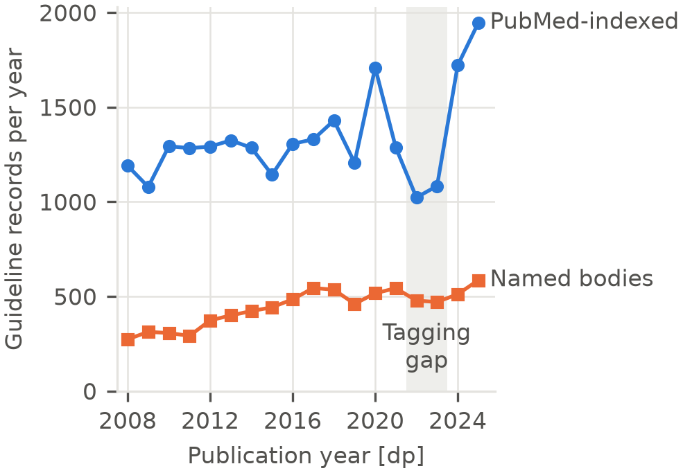
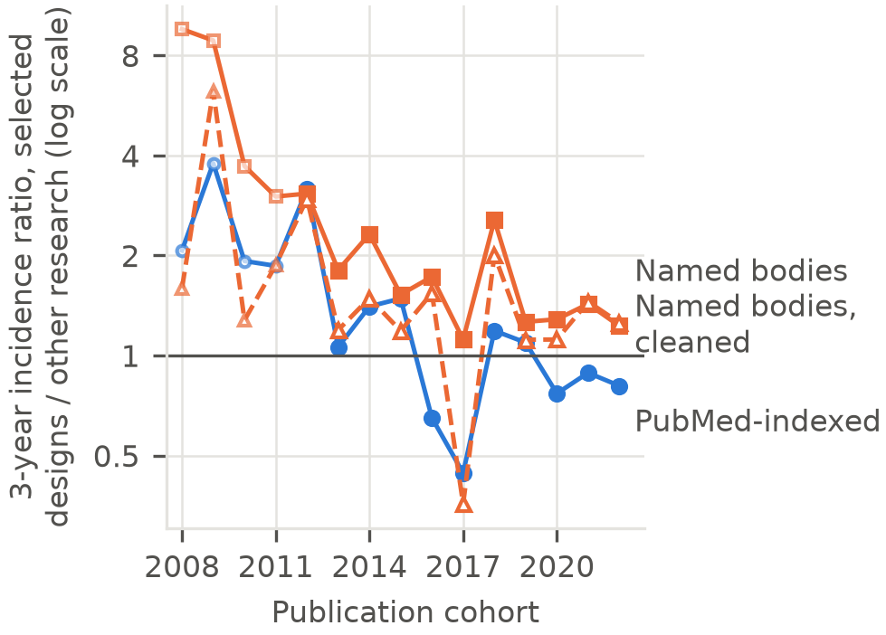
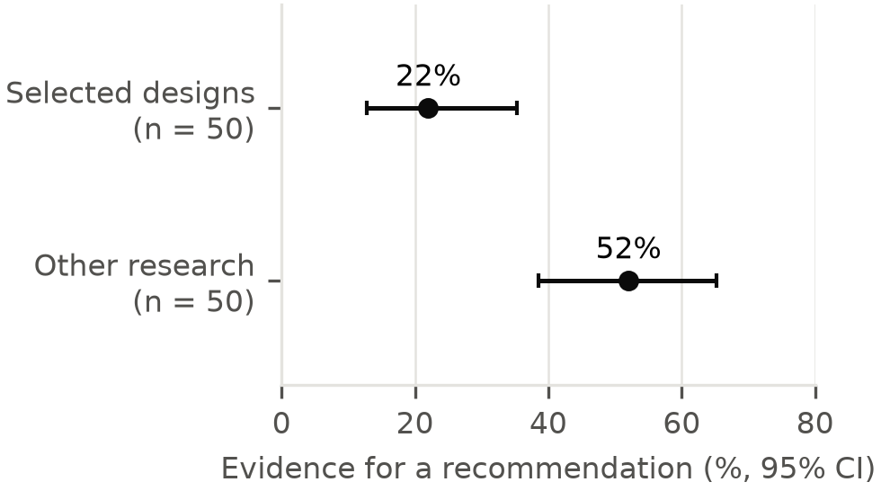

# Online Resource 1: Supplementary material

**Article:** Guideline citation and the growth of PubMed: a pre-registered cohort study, 2008–2024

**Journal:** *Scientometrics*

**Author:** Jordan Fulcher, independent researcher, Norwich, United Kingdom. Corresponding author: jfulcherresearch@gmail.com

Symbols are defined in main-text §2.2: F1 = PubMed-indexed guidelines, F2 = named-body guidelines, D = research literature, P1 = papers cited within 5 years, β = cohort trend, g₁ − g_D = growth gap. Code and data: https://github.com/JFulcher74/guideline-cited-evidence.

---

## S1. Validation gates in detail

- **G1 (coverage).** iCite reference coverage of F1 was 0.70 or above from 2008 (0.88 in 2025), so the 2008 start was retained.
- **G2 (eligibility).** Single coder; 200 F1 and 100 F2 records; blind recode of 25% after at least 14 days.
  - F1 precision 0.895 (95% CI 0.845–0.930; κ 0.61).
  - F2 precision 0.630 (0.532–0.718; κ 0.73), below the 0.80 threshold. F2 is reported with this shortfall stated.
- **G3 (NICE matching).** 85.5% (83.9–87.0%) of journal-like NICE references matched a PMID; 79.3% of all references.
- **G4 (citation context).** 100 guideline–citation pairs. 52% (39–65%) of citations to other research papers were evidence for a recommendation, against 22% (13–35%) for selected-design papers (κ 0.38). Fig. S3.
- **Coverage audit.** Coverage differed by journal and full-text availability, which triggered the stable-coverage-journals sensitivity analysis (S6).

## S2. Cleaned named-body guidelines (added sensitivity analysis; deviation 1)

- A rule-based filter removed F2 records with research, comment or correspondence publication types, or research-about-guideline titles. It was decided after G2 scoring and before any outcome analysis.
- Validated blind on 70 new records: kept records had precision 0.80 (0.67–0.89); 13 of 20 dropped records were eligible, so the filter also removes some true guidelines.
- 5,411 guidelines (4,811 with references). Five-year probability 0.90% (2008) to 0.73% (2019). β = −0.013 (−0.017 to −0.003); P1 growth 2.9%/yr; growth gap −1.75 (−2.60 to −1.29). H1 and H2 supported.

## S3. Breakpoints

- Continuous segmented regression with a bootstrap two-break test, cohorts 2008–2020.
- Every estimated break sat at 2018, the latest the grid allows, driven by the 2019–2020 cohorts and especially the 2020 COVID surge (two-break p 0.04–0.24).
- Excluding 2020: F1 P1 break at 2010 (−2.1 → −0.3%/yr; ΔAIC against no break +3.3, so no supported break); F2 P1 break at 2013 (4.3 → 0.5%/yr; ΔAIC −11.3). Five-year incidence breaks at 2011–2013, all with continued decline after the break.
- The 2018 "break" therefore reflects the COVID publication surge, not a lasting change.

## S4. Selected high-volume designs (RQ5)

- Six pre-specified designs that can be produced at scale from public data (e.g. two-sample Mendelian randomisation, NHANES cross-sectional analyses, Global Burden of Disease reanalyses) (Byrne & Stender, 2025; Munafò et al., 2024; Suchak et al., 2025), analysed as one group.
- Model: logit h = f(a) + β·c + γ·g + δ₁·g·c + δ₂·g·max(0, Y − 2018).
- In the 2008 cohort these papers were more likely than other research to be cited: γ = 1.02 (0.07 to 1.16) in F1 and 1.53 (1.35 to 1.68) in F2 (log odds ratios).
- The advantage declined by about 10–13% a year before 2018: δ₁ = −0.13 (−0.17 to −0.02) in F1 and −0.11 (−0.14 to −0.08) in F2.
- Three-year cumulative-incidence ratio, selected designs ÷ other research, pooled across cohorts (each cohort weighted by its size; `scripts/26_pooled_selected_ratios.py`): 1.41 (F1), 2.60 (F2) and 1.57 (cleaned F2) for the 2008–2017 cohorts, against 0.87, 1.36 and 1.29 for 2018–2022. Geometric means of the cohort ratios are similar (1.50, 2.86, 1.55 against 0.94, 1.49, 1.35). Unweighted arithmetic means of the cohort ratios (1.79 and 3.68 against 0.95 and 1.55) are inflated by the small, noisy early cohorts and are not used. The selected designs contributed 5,703 papers to the 2008–2017 cohorts and 16,979 to 2018–2022 (Supplementary Figure S2).
- G4 showed these citations were mostly background (22% evidence for a recommendation). This is not evidence that these designs inform recommendations, nor that individual papers are of low value.

## S5. A further change after 2022 (H3)

- **(a)** The selected-design share of D had an estimated break at 2019: its annual growth rate rose from 15% to 43%. An added 2022 hinge was not supported (p = 0.067).
- **(b)** A hinge at 2022 in the hazard of citation was positive: F1 θ = 0.080 (0.055 to 0.181), F2 0.068 (0.047 to 0.148).
- Why 42% of replicates failed: the moving-block bootstrap resamples the 17 cohorts (2008–2024) in blocks of 3 with random start points and no end-of-series stratification. A replicate that draws no block containing the 2023 or 2024 cohort has max(0, Y − 2022) = 0 for every sampled cohort, so θ is not identified.
- H3 formally met its criterion through (b), but we regard it as not robust: 42% of bootstrap replicates could not estimate θ; the affected cohorts had only 1–2 years of follow-up; and those years coincide with the recovery of F1 indexing. The protocol stated in advance that (b) would have little power.

## S6. All sensitivity analyses

| Specification | Frame | β (95% CI) | Growth gap, points/yr (95% CI) | H1 | H2 |
|---|---|---|---|---|---|
| **Primary** | F1 | −0.019 (−0.030 to 0.022) | −4.11 (−5.82 to −2.80) | NS | S |
| | F2 | −0.017 (−0.022 to −0.007) | −1.96 (−2.92 to −1.56) | S | S |
| | F2 cleaned | −0.013 (−0.017 to −0.003) | −1.75 (−2.60 to −1.29) | S | S |
| Unweighted | F1 | −0.011 (−0.022 to 0.030) | −3.43 (−4.74 to −2.36) | NS | S |
| | F2 | −0.012 (−0.018 to 0.002) | −1.67 (−3.24 to −1.03) | NS | S |
| | F2 cleaned | −0.008 (−0.012 to 0.008) | −1.43 (−2.81 to −0.74) | NS | S |
| Entry date [edat] | F1 | −0.014 (−0.025 to 0.023) | −3.62 (−5.17 to −2.80) | NS | S |
| | F2 | −0.013 (−0.019 to −0.006) | −1.35 (−2.94 to −0.34) | S | S |
| | F2 cleaned | −0.009 (−0.015 to −0.002) | −1.20 (−2.61 to −0.17) | S | S |
| D-Humans | F1 | −0.017 (−0.028 to 0.022) | −3.73 (−5.40 to −2.43) | NS | S |
| | F2 | −0.012 (−0.016 to −0.003) | −1.40 (−2.22 to −0.96) | S | S |
| | F2 cleaned | −0.007 (−0.011 to 0.002) | −1.15 (−1.80 to −0.70) | NS | S |
| D-all | F1 | −0.019 (−0.031 to 0.023) | −4.05 (−5.73 to −2.63) | NS | S |
| | F2 | −0.017 (−0.022 to −0.007) | −1.90 (−2.94 to −1.53) | S | S |
| | F2 cleaned | −0.013 (−0.017 to −0.003) | −1.70 (−2.60 to −1.23) | S | S |
| Headline age 3 years* | F1 | — | −4.28 (−5.78 to −3.01) | — | S |
| | F2 | — | −1.72 (−2.73 to −0.64) | — | S |
| | F2 cleaned | — | −1.50 (−2.79 to 0.02) | — | NS |
| Excluding 2020–21 | F1 | −0.021 (−0.037 to 0.014) | −4.91 (−5.87 to −4.04) | NS | S |
| | F2 | −0.018 (−0.025 to −0.008) | −2.26 (−3.15 to −1.54) | S | S |
| | F2 cleaned | −0.013 (−0.020 to −0.002) | −1.93 (−2.71 to −1.19) | S | S |
| Established journals (D-journals) | F1 | −0.010 (−0.019 to 0.027) | −2.97 (−4.38 to −1.93) | NS | S |
| | F2 | −0.005 (−0.008 to 0.002) | −0.58 (−1.40 to 0.05) | NS | NS |
| | F2 cleaned | 0.001 (−0.003 to 0.008) | −0.27 (−0.90 to 0.35) | NS | NS |
| Stable-coverage journals | F1 | −0.018 (−0.028 to 0.019) | −3.83 (−5.16 to −2.87) | NS | S |
| | F2 | −0.019 (−0.025 to 0.002) | −2.52 (−4.68 to −1.39) | NS | S |
| | F2 cleaned | −0.015 (−0.021 to 0.007) | −2.30 (−4.36 to −1.28) | NS | S |
| *Exploratory:* censored at 2021 | F1 | −0.054 (−0.063 to −0.047) | −5.48 (−7.47 to −3.99) | S | S |
| | F2 | −0.024 (−0.037 to −0.017) | −2.40 (−4.01 to −1.19) | S | S |
| | F2 cleaned | −0.021 (−0.033 to −0.015) | −2.12 (−3.59 to −0.71) | S | S |

S = supported; NS = not supported. *β does not depend on the headline age, so it is not repeated. 8-year headline age (growth gap only): F1 −4.27 (−6.39 to −2.04), F2 −2.51 (−3.68 to −1.47), F2 cleaned −2.03 (−3.37 to −0.78) (`data/processed/primary/dp_weighted_D_summary.csv`). Proportional-hazards check (age × cohort, ages 0–1 as reference): F1 +0.005 (ages 2–4), +0.049 (ages 5+); F2 −0.009, −0.009; F2 cleaned −0.002, +0.002. F1 departs from proportionality at older ages.

## S7. NICE (descriptive)

- Pilot of 10 NICE guidelines, too small for a trend.
- Median citation age 9 years, against 7 for F1 guidelines from 2015–2020; 32% of NICE references were ≤5 years old, against 41% for F1.
- Only 23% of NICE-cited papers were also cited by any F1 guideline, and 9% by any F2 guideline.

## S8. Pre-specified decision rule

The protocol combined H1 and the direction of P1 growth into a single interpretive cell. Primary results: F1, "not diluted (unexpected; investigate the decomposition)", because both the β CI and the P1-growth CI included 0; F2 and cleaned F2, "diluted, with a growing absolute yield". The F1 cell reflects the 2022–23 indexing gap (main text §3.3); the decomposition it calls for is main text §3.4.

## S9. Bootstrap block length (post hoc)

Point estimates are unchanged; only the moving-block bootstrap intervals are recomputed (`scripts/25_block_sensitivity.py`, 999 replicates, same seed). Block 3 reproduces the registered intervals exactly.

| Frame | Block | β (95% CI) | Growth gap, points/yr (95% CI) | H1 | H2 |
|---|---|---|---|---|---|
| F1 | 2 | −0.019 (−0.029 to 0.007) | −4.11 (−5.54 to −2.71) | NS | S |
| F1 | 3 (registered) | −0.019 (−0.030 to 0.022) | −4.11 (−5.82 to −2.80) | NS | S |
| F1 | 4 | −0.019 (−0.033 to 0.024) | −4.11 (−5.84 to −2.70) | NS | S |
| F2 | 2 | −0.017 (−0.021 to −0.010) | −1.96 (−2.67 to −1.72) | S | S |
| F2 | 3 (registered) | −0.017 (−0.022 to −0.007) | −1.96 (−2.92 to −1.56) | S | S |
| F2 | 4 | −0.017 (−0.023 to −0.005) | −1.96 (−2.92 to −1.49) | S | S |
| F2 cleaned | 2 | −0.013 (−0.017 to −0.006) | −1.75 (−2.34 to −1.60) | S | S |
| F2 cleaned | 3 (registered) | −0.013 (−0.017 to −0.003) | −1.75 (−2.60 to −1.29) | S | S |
| F2 cleaned | 4 | −0.013 (−0.018 to −0.0004) | −1.75 (−2.60 to −1.21) | S | S |

Conclusions for H1 and H2 do not change with block length in any frame.

## S10. MEDLINE-only denominator (post hoc)

D-MEDLINE = D AND medline[sb] (`scripts/24_medline_extract.py`, run 2026-11-02; `scripts/19_primary.py --denom D_medline`). Yearly counts are de-duplicated to the earliest [dp] year, as for D. Cited papers were flagged by History-server intersection; 94.8% of guideline-cited papers in D are MEDLINE-indexed. D-MEDLINE grew 2.5% a year over cohorts 2008–2020 (D: 4.7%). MEDLINE status is as of the run date, so the newest cohorts are under-counted.

| Frame | β (95% CI) | Growth gap, points/yr (95% CI) | 5-year probability, 2008 → 2019 | H1 | H2 |
|---|---|---|---|---|---|
| F1 | −0.010 (−0.020 to 0.029) | −2.99 (−4.93 to −1.55) | 1 in 23 → 1 in 36 | NS | S |
| F2 | −0.006 (−0.010 to 0.004) | −0.67 (−1.27 to −0.44) | 1 in 80 → 1 in 91 | NS | S |
| F2 cleaned | −0.001 (−0.005 to 0.009) | −0.41 (−0.93 to −0.15) | 1 in 102 → 1 in 111 | NS | S |

S = supported; NS = not supported.

## S11. Search strategies and code lists (RECORD 6.1, 7.1)

All searches used PubMed (NCBI E-utilities). Exact strings, as run; full provenance, including run dates, is in `data/raw/extract/provenance.json`.

- **PubMed-indexed guidelines (F1):** `"Practice Guideline"[pt] NOT preprint[pt]`
- **Research literature (D):** `"Journal Article"[pt] NOT (Comment[pt] OR Editorial[pt] OR Letter[pt] OR News[pt] OR "Published Erratum"[pt] OR Guideline[pt] OR "Practice Guideline"[pt] OR preprint[pt])`
- **D-Humans:** D AND `Humans[mh]`; **D-all:** `all[sb] NOT preprint[pt]`; **D-MEDLINE (post hoc):** D AND `medline[sb]`
- **Named-body guidelines (F2):** for each body, `((<body rule>) AND (guideline*[tiab] OR recommendation*[tiab] OR "consensus statement"[tiab] OR "position statement"[tiab])) NOT (preprint[pt] OR Comment[pt] OR "Published Erratum"[pt] OR News[pt])`. Body rules:

| Body | Match rule |
|---|---|
| European Society of Cardiology | `"ESC Scientific Document Group"[cn] OR (("European Society of Cardiology"[ti] OR ESC[ti]) AND "Eur Heart J"[ta])` |
| American College of Cardiology / American Heart Association | `"Joint Committee on Clinical Practice Guidelines"[cn] OR "American College of Cardiology/American Heart Association Task Force on Practice Guidelines"[cn] OR (("American Heart Association"[ti] OR "American College of Cardiology"[ti] OR AHA[ti] OR ACC[ti] OR ASA[ti]) AND (Circulation[ta] OR "J Am Coll Cardiol"[ta] OR Stroke[ta] OR Hypertension[ta]))` |
| US Preventive Services Task Force | `"US Preventive Services Task Force"[cn] OR "U.S. Preventive Services Task Force"[cn] OR "Preventive Services Task Force"[ti]` |
| Canadian Task Force on Preventive Health Care | `"Canadian Task Force on Preventive Health Care"[cn] OR "Canadian Task Force on Preventive Health Care"[ti]` |
| National Institute for Health and Care Excellence | `"National Institute for Health and Care Excellence"[ti] OR "National Institute for Health and Clinical Excellence"[ti] OR (NICE[ti] AND BMJ[ta])` |
| Scottish Intercollegiate Guidelines Network | `"Scottish Intercollegiate Guidelines Network"[ti] OR (SIGN[ti] AND (BMJ[ta] OR Thorax[ta] OR "Scott Med J"[ta]))` |
| World Health Organization | `"World Health Organization"[cn] OR ("World Health Organization"[ad] AND ("World Health Organization"[ti] OR WHO[ti]) AND (guideline*[ti] OR recommendation*[ti]))` |
| US Centers for Disease Control and Prevention | `"MMWR Recomm Rep"[ta] OR "Centers for Disease Control and Prevention"[ti]` |
| AWMF (German S3 guidelines) | `AWMF[ti] OR "S3 guideline"[ti] OR "S3-Leitlinie"[ti] OR "S3 Leitlinie"[ti]` |
| Haute Autorité de Santé | `"Haute Autorite de Sante"[ti] OR "Haute Autorité de Santé"[ti] OR "French National Authority for Health"[ti]` |
| Infectious Diseases Society of America | `"Infectious Diseases Society of America"[ti] OR (IDSA[ti] AND "Clin Infect Dis"[ta])` |
| American Society of Clinical Oncology | `"American Society of Clinical Oncology"[ti] OR (ASCO[ti] AND ("J Clin Oncol"[ta] OR "JCO Oncol Pract"[ta] OR "J Oncol Pract"[ta]))` |
| European Society for Medical Oncology | `"ESMO Guidelines Committee"[cn] OR ESMO[ti]` |
| National Comprehensive Cancer Network | `"J Natl Compr Canc Netw"[ta] AND (NCCN[ti] OR "Clinical Practice Guidelines in Oncology"[ti])` |
| KDIGO | `KDIGO[ti] OR "Kidney Disease: Improving Global Outcomes"[cn] OR "Kidney Disease: Improving Global Outcomes"[ti]` |
| American Thoracic Society / European Respiratory Society | `(("American Thoracic Society"[ti] OR "European Respiratory Society"[ti] OR ATS[ti] OR ERS[ti]) AND ("Am J Respir Crit Care Med"[ta] OR "Eur Respir J"[ta] OR "Ann Am Thorac Soc"[ta])) OR "American Thoracic Society"[cn]` |
| American College of Chest Physicians | `"American College of Chest Physicians"[ti] OR (CHEST[ti] AND Chest[ta])` |
| American Gastroenterological Association | `"American Gastroenterological Association"[ti] OR (AGA[ti] AND Gastroenterology[ta])` |
| American College of Gastroenterology | `"American College of Gastroenterology"[ti] OR (ACG[ti] AND "Am J Gastroenterol"[ta])` |
| European Association for the Study of the Liver | `"European Association for the Study of the Liver"[cn] OR EASL[ti]` |
| American Association for the Study of Liver Diseases | `AASLD[ti] OR "American Association for the Study of Liver Diseases"[ti]` |
| American Academy of Neurology | `"American Academy of Neurology"[ti] OR (AAN[ti] AND Neurology[ta])` |
| American College of Rheumatology | `"American College of Rheumatology"[ti] OR (ACR[ti] AND ("Arthritis Care Res (Hoboken)"[ta] OR "Arthritis Rheumatol"[ta]))` |
| American College of Radiology | `"ACR Appropriateness Criteria"[ti]` |
| American Diabetes Association | `"Standards of Medical Care in Diabetes"[ti] OR "Standards of Care in Diabetes"[ti] OR "American Diabetes Association Professional Practice Committee"[cn]` |
| Endocrine Society | `"Endocrine Society"[ti] AND "J Clin Endocrinol Metab"[ta]` |
| American College of Obstetricians and Gynecologists | `"American College of Obstetricians and Gynecologists"[cn] OR ("Obstet Gynecol"[ta] AND ("Practice Bulletin"[ti] OR "Committee Opinion"[ti] OR ACOG[ti]))` |
| American Academy of Pediatrics | `"American Academy of Pediatrics"[cn] OR ("American Academy of Pediatrics"[ti] AND Pediatrics[ta])` |
| American College of Physicians | `"Clinical Guidelines Committee of the American College of Physicians"[cn] OR "American College of Physicians"[ti]` |
| American Urological Association | `"American Urological Association"[ti] OR (AUA[ti] AND "J Urol"[ta])` |
| European Association of Urology | `"European Association of Urology"[ti] OR (EAU[ti] AND "Eur Urol"[ta])` |

- **Selected high-volume designs:** `((("two-sample"[tiab] OR "two sample"[tiab]) AND Mendelian[tiab] AND (randomization[tiab] OR randomisation[tiab])) OR (bibliometric*[tiab] OR scientometric*[tiab]) OR ((NHANES[tiab] OR "National Health and Nutrition Examination Survey"[tiab]) AND ("cross-sectional"[tiab] OR "cross sectional"[tiab])) OR ("Global Burden of Disease"[tiab] NOT (GBD[cn] OR "Global Burden of Disease"[cn] OR "Global Burden of Diseases"[cn] OR "Institute for Health Metrics and Evaluation"[ad])) OR "network pharmacology"[tiab] OR ((FAERS[tiab] OR "Adverse Event Reporting System"[tiab]) AND disproportionality[tiab]))`

## Supplementary figures

**Fig. S1** Guideline records per publication year, 2008–2025. Circles: PubMed-indexed guidelines (F1). Squares: named-body guidelines (F2). The shaded band marks the 2022–23 fall in PubMed "Practice Guideline" tagging, which is absent from named-body guidelines

**Fig. S2** Ratio of 3-year cumulative incidence of first guideline citation, selected high-volume designs ÷ other research, by publication cohort (2008–2022; log scale). Circles: PubMed-indexed guidelines. Squares, solid line: named-body guidelines. Triangles, dashed line: the cleaned named-body set. Small open markers: the 2008–2011 cohorts, which contain few selected-design papers. Cohorts run to 2022 because the window is 3 years; the horizontal line marks a ratio of 1

**Fig. S3** Share of guideline citations that are evidence for a recommendation, selected-design papers against other research papers (G4 sample of PubMed-indexed guidelines; n = 50 citations per group). Points: estimates; bars: Wilson 95% confidence intervals. Intra-rater κ = 0.38
